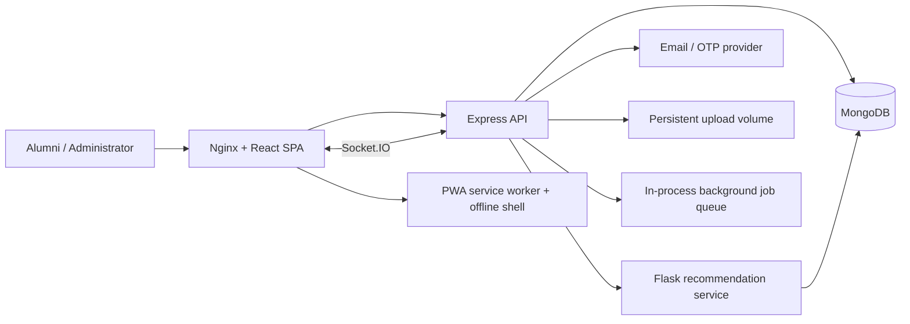
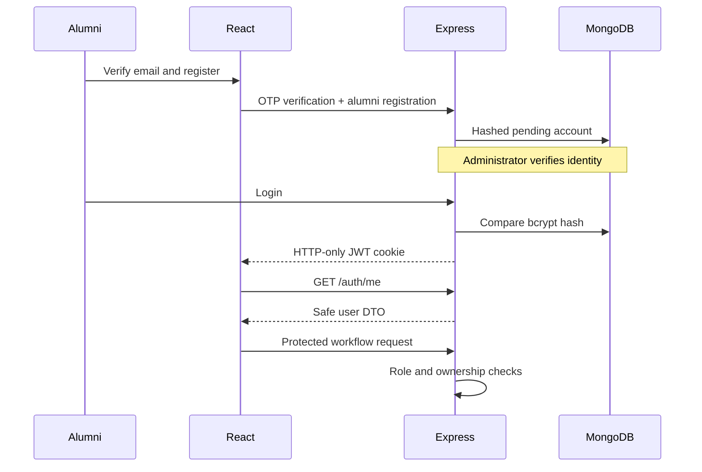
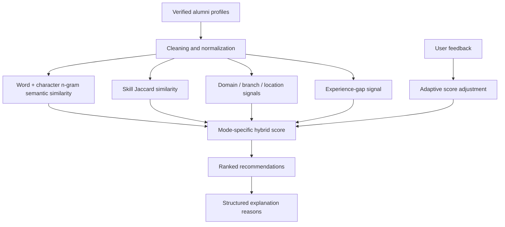
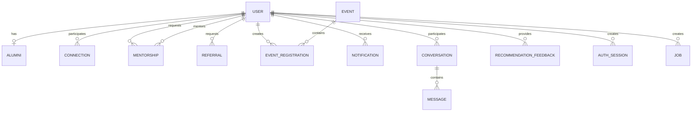

# System architecture

## Container architecture

## Authentication and authorization

Every new JWT contains a random `jti` linked to an `AuthSession`. Protected
middleware verifies both token signature and active server-side session.
Password change, reset, device revocation and logout-all invalidate sessions.

## Recommendation pipeline

## Major collections

## Trust boundaries

- Browser state is not proof of authentication; `/auth/me` validates the cookie.
- Credentials exist only on `User` and are excluded from normal queries.
- Administrator provisioning is controlled by environment variables.
- Mutations require role and resource-ownership checks.
- ML results include only verified alumni and exclude the requesting user.
- Uploaded bulk data is CSV-only to minimize parser attack surface.
- Socket connections validate the same signed JWT used by HTTP requests.
- Conversations are readable only by their participants.
- Directory, assistant, graph, mentoring, messaging and connections enforce
  privacy preferences and blocking at the backend.
- Assistant mutations require a named confirmation preview before execution.
- The PWA service worker caches navigation shell/static assets, not private API responses.

## Scalability controls

- High-volume alumni, notification, conversation, and message reads are paginated.
- Recommendation responses use a short-lived per-user cache invalidated by feedback.
- Email delivery is moved off the request path through a background job queue.
- Search and workflow fields have compound and text indexes.
- CSV uploads are memory-limited, record-limited, extension/MIME checked, and reject binary content.
- Cache and queue storage is process-local for this deployment; their service interfaces
  can be replaced by Redis and a durable worker for multi-instance production.
