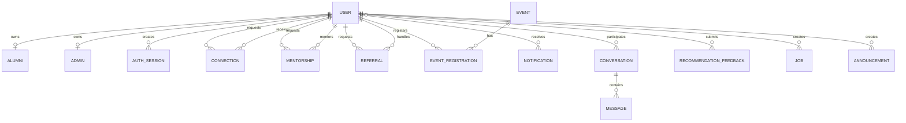
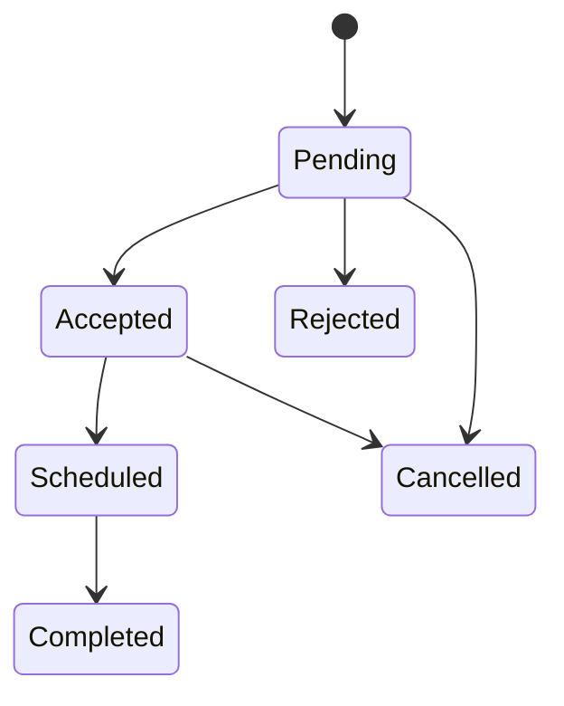
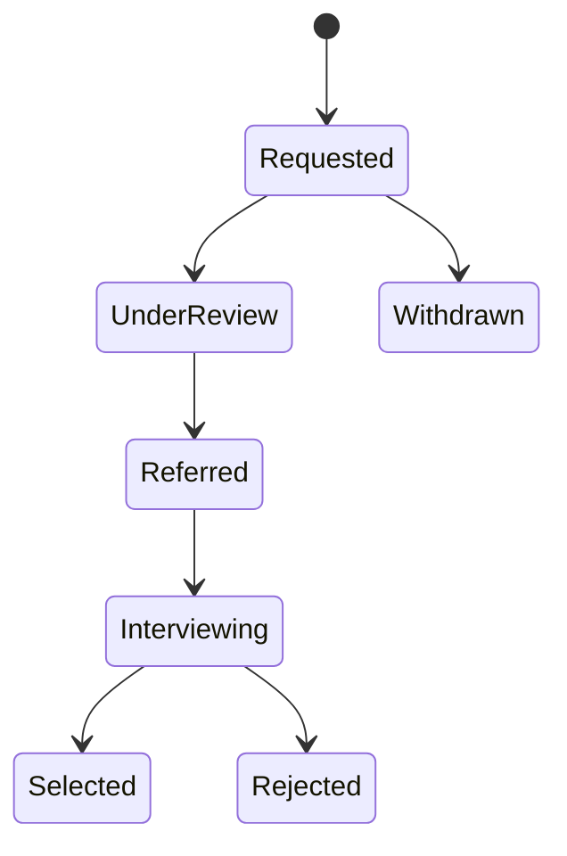

# Database design

## 1. Design principles

- Authentication credentials belong only to `User`.
- Alumni and administrator profile records reference `User`.
- Workflow collections preserve ownership and history.
- Sensitive or high-volume fields have explicit indexes.
- References use MongoDB ObjectIds and are validated by authorization logic.

## 2. Entity relationship overview

## 3. Principal collections

### User

Stores identity, email, bcrypt password, role, approval state, privacy
preferences, notification preferences, blocked-user references, password reset
token hash/expiry, and password-change time.

Security-sensitive fields such as `password`, `passwordResetTokenHash`, and
`passwordResetExpiresAt` are excluded from default Mongoose selection.

### Alumni

Stores academic information, employment, company, designation, domain,
location, biography, skills, work/education arrays, social profiles,
verification state and uploaded profile asset metadata.

Important indexes:

- verified + branch + graduation year
- company + designation
- text index across name, company, designation and skills

### AuthSession

Stores a random JWT token identifier, user agent, IP address, last activity,
expiry and revocation time. A TTL index removes expired sessions. The raw JWT is
never stored.

### Connection

Stores requester, recipient, optional message and pending/accepted/rejected
state. The requester-recipient pair has a unique index.

### Mentorship

Stores requester/mentor identity snapshots, topic, mode, message, goal,
expected outcome, lifecycle status, scheduling details, meeting link, notes,
milestones, progress notes, completion, rating and feedback.

### Referral

Stores requester, target role, company, rationale, assignee, optional links,
deadline, current state and append-only status history. Older workflow status
values remain accepted for backward compatibility.

### Event and EventRegistration

`Event` stores content, date, location, capacity and administrative metadata.
`EventRegistration` stores one unique event-user registration with registered,
waitlisted, cancelled or attended state and optional check-in metadata.

### Conversation and Message

`Conversation` contains participant references and last-message time. `Message`
contains sender, recipient, body and read state. Backend authorization ensures
only participants read a conversation.

### Notification

Stores recipient, category, content, link, read time and metadata. Reminder keys
are unique per recipient to prevent duplicate reminder generation.

### RecommendationFeedback

Stores viewer, recommended user, recommendation mode, action, score and model
version. It supports bounded adaptation and cache invalidation.

## 4. Workflow state models

## 5. Data integrity and privacy

- Application-level ownership checks complement schema validation.
- Blocking and visibility preferences are evaluated before directory,
  assistant, graph, message and connection responses.
- Personal-data export omits password and reset credentials.
- Session documents expire automatically.
- Reset token hashes are cleared after successful reset.
- The recommendation service receives only profile attributes required to rank.

## 6. Backup and migration guidance

Before schema migrations:

1. Create a MongoDB backup.
2. Run migration scripts in dry-run mode when available.
3. Count affected documents.
4. Apply idempotent updates using `$set` only for missing defaults.
5. Run backend integration and manual login tests.
6. Retain the backup until acceptance testing is complete.
