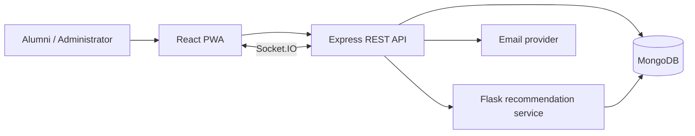

# CMReunite: An Intelligent and Explainable Alumni Engagement Platform

## Abstract

CMReunite is a full-stack alumni engagement platform that converts fragmented
institutional records into a verified, active and measurable professional
network. It supports alumni onboarding, profile discovery, connections,
real-time messaging, mentorship, referrals, events, jobs, communities,
notifications, institutional analytics, privacy controls and secure session
management. An independent Python service provides purpose-specific,
explainable alumni recommendations. A grounded natural-language assistant and
interactive network graph improve discovery without inventing profile facts.

The system uses a React progressive web application, Express and Socket.IO
backend, MongoDB database and Flask/scikit-learn recommendation service.
Engineering quality is supported through validation, role/ownership
authorization, HTTP-only JWT cookies, revocable sessions, bcrypt passwords,
privacy enforcement, OpenAPI documentation and automated unit, integration, ML
and browser tests.

## 1. Introduction

### 1.1 Background

Institutions often hold alumni information in isolated spreadsheets, social
groups or outdated portals. These systems store identities but rarely support
structured mentoring, referral outcomes, relationship discovery or evidence of
engagement. Students and recent alumni struggle to identify the right people,
while administrators cannot reliably measure the network’s impact.

### 1.2 Problem statement

There is a need for a secure institutional platform that verifies alumni,
supports accountable engagement workflows, recommends relevant people
explainably, respects personal-data choices and produces measurable outcomes.

### 1.3 Proposed solution

CMReunite combines:

- verified alumni profiles and privacy-aware discovery;
- connection, messaging, mentorship and referral workflows;
- event, job, announcement, recognition and community modules;
- explainable recommendation and grounded assistant services;
- relationship-graph visualization and graph algorithms;
- live administrator analytics;
- secure account and session management;
- installable PWA and presentation mode.

## 2. Objectives

1. Build a verified and searchable alumni directory.
2. Enable structured networking, mentorship and career-referral processes.
3. Provide transparent purpose-specific recommendation results.
4. Give users enforceable privacy and account-security controls.
5. Give institutions real engagement measures instead of static claims.
6. Deliver a testable, documented and deployable final-year system.

## 3. Existing-system limitations

- Fragmented or stale profile records
- No institutional identity-verification workflow
- Weak search without relevance ranking
- Unstructured mentoring and referral conversations
- No outcome history or engagement analytics
- Limited privacy and account-recovery controls
- Black-box or unmeasured recommendation claims

## 4. Development methodology

The project followed incremental milestones:

1. security and onboarding foundation;
2. institutional and engagement workflows;
3. explainable recommendation service;
4. deployment, testing and observability;
5. real-time communication and adaptive feedback;
6. assistant, graph and evaluation lab;
7. mentorship/referral depth and live analytics;
8. privacy, notifications, PWA and presentation mode;
9. revocable sessions and secure account recovery.

Each milestone preserved existing behavior, added automated checks and updated
documentation.

## 5. Technology stack

| Layer | Technology |
|---|---|
| Web client | React 18, Redux Toolkit, React Router, Tailwind CSS, Vite |
| API | Node.js, Express, Mongoose, Zod |
| Real time | Socket.IO |
| Database | MongoDB |
| Authentication | bcrypt, JWT, HTTP-only cookies, server-side session records |
| ML | Python, Flask, scikit-learn, NumPy, PyMongo |
| Production web | Nginx, Gunicorn; optional Docker Compose |
| Quality | Node test runner, Jest/Supertest, Python unittest, ESLint, Playwright |

## 6. System design



The frontend contains public and protected lazy-loaded routes. The Express layer
performs authentication, authorization, validation, workflow processing and
privacy filtering. MongoDB is the source of truth. The recommendation service
reads profiles, calculates mode-specific hybrid scores and returns explanations.

Detailed diagrams are provided in `ARCHITECTURE.md`,
`DATABASE_DESIGN.md`, and `USE_CASES_AND_DFD.md`.

## 7. Major modules

### 7.1 Secure onboarding and accounts

Registration requires OTP verification and administrator approval. Passwords
are bcrypt-hashed. Each login creates a revocable session referenced by a JWT
`jti`. Users can inspect devices, revoke sessions, sign out everywhere, change
passwords and use privacy-safe password recovery. Reset tokens are random,
SHA-256-hashed at rest, single-use and valid for 15 minutes.

### 7.2 Directory, connections and messaging

Alumni profiles contain education, work, skills and social information.
Directory discovery honors profile visibility, blocking and contact redaction.
Users manage connection requests and exchange participant-authorized stored
messages with live Socket.IO delivery.

### 7.3 Network graph

The graph visualizes accepted relationships and separately labelled discovery
links from shared branches or companies. It provides search, company filters,
zoom, pan, mutual-connection counts and breadth-first shortest accepted paths.

### 7.4 Mentorship

The lifecycle includes mentor discovery, topic, mode, goals, outcomes,
acceptance, scheduling, meeting details, milestones, progress notes, completion,
rating and feedback.

### 7.5 Referrals

Referral requests record the role, company, rationale, links and deadline.
The pipeline moves through requested, under-review, referred, interviewing and
selected/rejected states with timestamped history.

### 7.6 Institutional content and analytics

The system manages events, registrations/waitlists, jobs, announcements,
recognition, stories, forums, resources and contributions. Live reports measure
users, approvals, connections, mentorship completion, referral outcomes, event
attendance, messages and registration growth. CSV export supports analysis.

### 7.7 Notifications

Stored notifications support read state, categories, filtering, in-app/email
preference, digest choice and quiet hours. Idempotent reminders are generated
for events, mentoring sessions and referral deadlines approaching within 48
hours.

### 7.8 Grounded assistant

The assistant extracts intent, years and keywords from natural-language
questions, scores actual profile fields and displays evidence. It supports
recent conversation context and workflow navigation. Connection actions use a
preview/confirmation protocol and recheck privacy, blocking and duplicates.

### 7.9 Explainable recommendations

The service combines word/character TF-IDF profile similarity, normalized skill
Jaccard similarity, domain, branch, location and experience signals. Weights
vary by network, mentor and referral mode. Explicit feedback hides candidates or
applies a bounded adjustment. Results include component signals and reasons.

### 7.10 Privacy and PWA

Users control discovery, contact fields, messages, connection requests,
mentorship availability and blocking, and may export their data. The production
client includes a manifest, service worker, static-shell caching and offline
fallback. API responses are not cached by the service worker.

## 8. Recommendation methodology

```text
score =
  text_similarity × text_weight +
  skill_similarity × skill_weight +
  domain_match × domain_weight +
  branch_match × branch_weight +
  location_match × location_weight +
  experience_score × experience_weight +
  bounded_feedback_adjustment
```

The starter mentor benchmark contains four labelled scenarios. At K=1, the
skills-only baseline records Precision/Recall/NDCG of 0.75, while content-only
and hybrid-adaptive models record 1.00 on those four fixtures. These values
demonstrate the evaluation workflow only; they are not sufficient for a broad
accuracy claim.

## 9. Security and privacy

Implemented controls include:

- bcrypt passwords and excluded credential fields;
- HTTP-only, SameSite/secure environment-aware cookies;
- signed JWTs plus server-side revocable sessions;
- generic recovery responses and hashed expiring reset tokens;
- role and ownership authorization;
- Zod validation, body limits and rate limiting;
- Helmet headers and CORS allow-list;
- bounded file/CSV processing;
- backend-enforced privacy and blocking;
- confirmed assistant mutations;
- request IDs and safe structured logging.

Residual risks and production improvements are detailed in
`SECURITY_AND_PRIVACY.md`.

## 10. Testing and results

Measured on 26 July 2026:

| Suite | Result |
|---|---:|
| Backend unit/security/workflow | 22 passed |
| Backend database integration | 6 passed |
| ML unit/evaluation | 9 passed |
| Chromium end-to-end | 11 passed |
| Frontend lint | Passed |
| Production build | Passed |

The tests cover password security, sessions, privacy defaults, workflow model
states, recommendation ranking/metrics, authentication journeys, messaging,
assistant, graph, privacy, presentation and recovery behavior.

## 11. Advantages

- Broad institutional feature coverage with linked workflows
- Explainable rather than opaque matching
- Grounded assistant independent of paid AI services
- Graph-computing component with visible algorithms
- Enforceable privacy and revocable account sessions
- Reproducible evaluation and multiple automated test layers
- Presentation-ready interface and documentation

## 12. Limitations

- The labelled recommendation dataset is small.
- The assistant uses deterministic intent parsing rather than a general LLM.
- Email depends on external credentials.
- Local uploads, cache and job queue are not multi-instance infrastructure.
- The service worker provides shell/offline fallback, not offline mutations.
- Automated permanent account deletion requires a retention policy.
- Real institutional load and security testing remain necessary.

## 13. Future scope

- Larger human-labelled recommendation study
- Sentence embeddings and learning-to-rank
- Durable queue/cache and centralized observability
- Managed object storage and malware scanning
- Institution-level multi-tenancy
- Native push notifications
- Calendar/video integrations
- Governance-approved deletion and retention automation

## 14. Conclusion

CMReunite demonstrates how alumni data can support real, measurable engagement
rather than remain a static directory. The project integrates secure full-stack
engineering, structured workflows, real-time communication, graph discovery,
explainable machine learning, privacy controls and reproducible quality
evidence. Its current limitations are explicit, and its modular architecture
provides a practical path from final-year prototype to institutional deployment.
