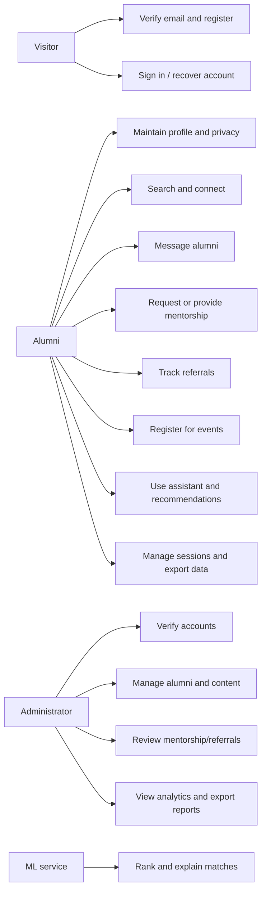
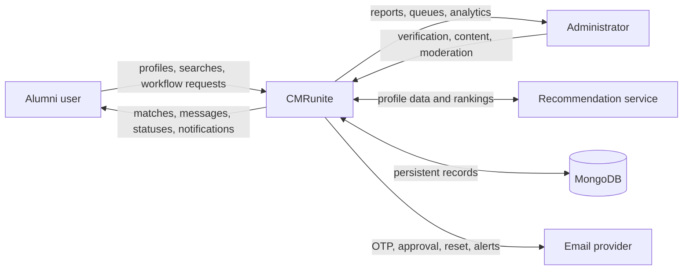
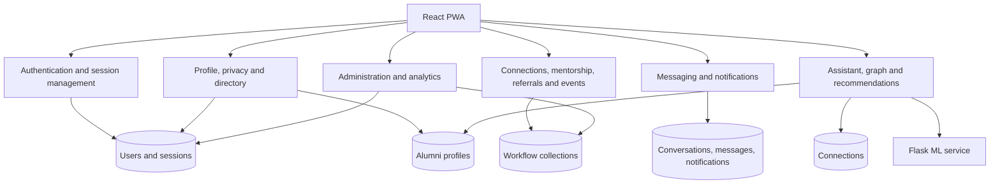
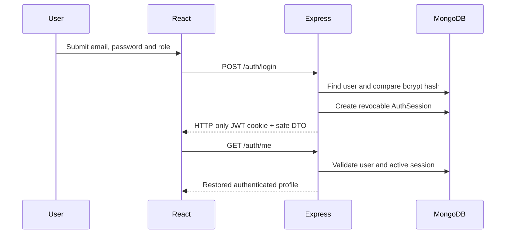
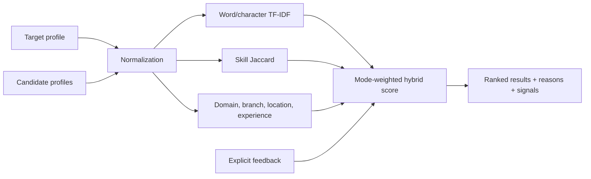
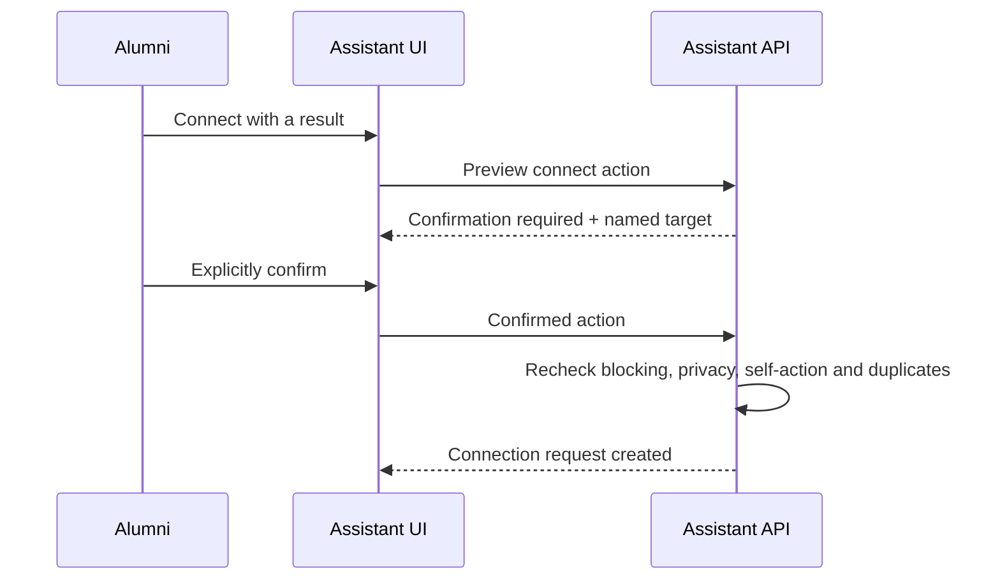

# Use cases and data-flow diagrams

## 1. Use-case model



## 2. Level-0 context diagram



## 3. Level-1 application data flow



## 4. Authentication sequence



## 5. Password reset sequence

```mermaid
sequenceDiagram
    participant U as User
    participant A as Express
    participant D as MongoDB
    participant E as Email
    U->>A: Request reset for email
    A->>D: Find approved account
    A->>D: Store SHA-256 token hash + 15-minute expiry
    A-->>U: Generic response
    A->>E: Send raw token in reset link
    U->>A: Submit token + strong new password
    A->>D: Match hash and expiry
    A->>D: Save bcrypt password; clear token; revoke sessions
    A-->>U: Reset completed
```

## 6. Recommendation data flow



## 7. Trust-sensitive assistant action


